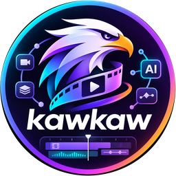

<p align="center"></p>

<h1 align="center">KawKaw</h1>

<p align="center"><b>Connect Claude or ChatGPT to Adobe Premiere Pro and After Effects.</b><br>
Custom one-click buttons · music-video track presets · automatic audio-gap removal · AI gap fill with Kling / Higgsfield</p>

Free and open source (MIT). Works on **macOS (Apple Silicon & Intel) and Windows**.

```
 Claude desktop ──(MCP, local)────┐
 ChatGPT / Atlas ─(MCP, https)──┐ │
                    Cloudflare  ▼ ▼
                KawKaw  (runs on your computer)
                ├── Premiere Pro panel (UXP)  ← your buttons, AI Fill, presets
                ├── After Effects (ExtendScript)
                ├── ffmpeg (silence detection)
                └── Kling / Higgsfield APIs, or a "drop the file here" folder
```

---

## Features

| | |
|---|---|
| **Custom buttons** | A grid of buttons in Premiere. Each runs a built-in action or a *macro* (several actions in a row). Change them in Settings or just ask Claude: *"add a button that names my tracks and drops beat markers."* |
| **Remove audio gaps** | Select clip(s), press the button. ffmpeg finds the silences (threshold / min length / padding are adjustable), and KawKaw cuts them out and closes the gaps. One undo step per edit. A *dry run* tells you how much would be cut. |
| **AI gap fill** | Set In/Out → **New gap from In/Out** grabs the frame before In and the frame at Out as first/last frames. Or press **Empty gap** and choose your own first/last frame images from any drive. Claude can *see* both frames and write the prompt. Generate with the **Higgsfield API**, the **Kling API**, or **Manual** (generate on the Kling/Higgsfield website, drop the file into the gap's folder). The clip is placed on the timeline automatically, trimmed to the gap. |
| **Music-video presets** | e.g. `V1 Close-Up Master · V2 Wide Master · V3 Drone · V4 B-Roll …` plus BPM and plain-language cutting rules. One click names your tracks and drops beat markers; Claude reads the rules when you ask it to cut. |
| **After Effects** | *Send In/Out to AE* rebuilds the Premiere range as an AE comp (every clip becomes a layer at the same time). Claude can also run any AE script (make comps, titles, expressions, render queue…). |
| **Claude tools** | 26 MCP tools: read the timeline, trim/move/delete/place clips, lay out cut lists, markers, export frames (Claude sees them), presets, buttons, gaps, AE. |

---

## Install (the easy way)

Go to the **[Releases](../../releases)** page and download:

| Your computer | File |
|---|---|
| Windows | `KawKaw-Setup-x.y.z.exe` |
| Mac with Apple chip (M1–M4) | `KawKaw-x.y.z-mac-apple-silicon.pkg` |
| Intel Mac (e.g. Intel iMac) | `KawKaw-x.y.z-mac-intel.pkg` |

Double-click it and follow the steps. Node.js is included, so there's nothing else to install. When it finishes:

1. Creative Cloud opens to install the **Premiere panel**. Click Install.
2. KawKaw's **settings page** opens in your browser.
3. **Restart Claude** (if you use it). In Premiere: **Window → UXP Plugins → KawKaw**. The badge turns green when connected.

To open KawKaw later, use the **KawKaw** icon (Start menu / Desktop on Windows, Applications on Mac).

> **First-time warnings:** KawKaw isn't signed with a paid Apple/Microsoft certificate yet. On Windows click *More info → Run anyway*. On Mac, if it says the installer can't be opened: right-click the .pkg → **Open**.

**If the panel doesn't install from Creative Cloud:** install **UXP Developer Tool** (free in Creative Cloud), turn on *Premiere → Settings → Plugins → Enable developer mode*, then *Add Plugin* → choose `premiere-plugin/manifest.json` inside the KawKaw folder → **Load**.

**After Effects:** turn on *Settings → Scripting & Expressions → Allow Scripts to Write Files and Access Network*.

### Requirements
- Premiere Pro 25.6 or newer (built for Premiere Pro 2027) · After Effects 2027 (optional)
- **Claude desktop app** and/or a **paid ChatGPT plan** that allows custom apps (see below)
- For API generation: a Higgsfield and/or Kling API key. They bill per request, separately from their website plans. *Manual* mode needs no keys.

### Install from source (developers)
Needs Node.js 20+. Download the repo, then double-click `install-mac.command` / `install-windows.bat`, or run `npm install && node bridge/src/cli.js setup`.

## Connect ChatGPT (or ChatGPT Atlas)

ChatGPT runs in the cloud, so it can't see programs on your computer directly. KawKaw opens a secure **Cloudflare tunnel** and gives you a secret link.

1. Open KawKaw settings → **ChatGPT & ChatGPT Atlas** → **Turn on ChatGPT**. After a few seconds you get a link like `https://something.trycloudflare.com/mcp/AbC123…`. Press **Copy**.
2. In ChatGPT: **Settings → Apps & Connectors**. Turn on **Developer mode** under *Advanced settings* if your account asks for it, then **Create**.
3. Name: `KawKaw` · MCP Server URL: *paste the link* · Authentication: **None** → Create.
4. In a chat, press **+** → choose **KawKaw** (or Developer mode → KawKaw) and ask away. ChatGPT Atlas uses the same ChatGPT account, so it works there too.

Good to know:
- **Have a home server that already runs a Cloudflare tunnel?** Choose **Through my home server's Cloudflare tunnel**. Enter the public URL (e.g. `https://kawkaw.yourdomain.com`) and the server's LAN address, then route that hostname on the server to `http://<this-computer-IP>:47322`. KawKaw only answers the server's IP, and only on the ChatGPT link. Allow Node.js through the firewall when Windows/macOS asks (private networks).
- **Got an invite code from a friend who runs a KawKaw Hub?** Choose **Join a KawKaw Hub**, paste the code and turn it on. You get a permanent link that keeps working even if their server loses power. Want to host one for your friends? See **[HUB.md](HUB.md)**.
- **The free link changes every time KawKaw restarts**, and you then update it in ChatGPT (edit the app → new URL). To get a permanent link, pick **My own domain** in settings and use a Cloudflare named tunnel on a domain you own (e.g. `kawkaw.yourdomain.com`). Paste the tunnel token and URL there.
- The link is secret. Anyone who has it can control Premiere/AE while KawKaw is running. **New link** makes the old one stop working.
- OpenAI decides which plans can use custom apps and whether they can *edit* (write) or only *read*. If ChatGPT only shows the read tools (timeline, frames, presets, gaps), your plan is limited to read-only.

## Auto-edit: folder + music → cut to the beat

Panel → **Presets** → choose a preset (e.g. **Ad / Commercial**) → set the **BPM**, how many beats per cut, and the length (whole song, 15, 30 or 60 s) → **Folder + Music → Edit**. Pick the footage folder and the song. KawKaw lays the clips on V1, cut on the beat from the playhead, with the music on A1 and the clips' own audio on A2. Each cut uses a fresh part of its clip, so shots don't repeat. Tick **Shuffle** for a random order. There's also an **Auto-Edit** button in the Buttons tab, and Claude can do it from the Chat tab.

## Chat with Claude inside Premiere

The panel's **Chat** tab lets you talk to Claude without leaving Premiere. Claude uses the same tools: it reads the timeline, names tracks, adds markers, cuts, removes audio gaps, sets up AI clips and drives After Effects.

It reaches Claude in one of two ways (KawKaw settings → **Assistant**):
- **Your Claude login through Claude Code** (recommended, uses your Claude plan). Install Claude Code from claude.com/claude-code, open a terminal, run `claude` once and log in. KawKaw finds it automatically.
- **An Anthropic API key** from console.anthropic.com. Pay per use, billed separately from Claude plans.

## Using it (Claude or ChatGPT)

Things you can say:

- *"Look at my timeline and tell me what's on each track."*
- *"Using my Music Video – Multicam preset, cut the chorus at 1:02–1:34 on V1–V4, one cut per bar."*
- *"Remove the audio gaps in the selected interview clip, but do a dry run first."*
- *"Look at my latest KawKaw gap and write a Kling prompt that bridges the two frames — slow drone push-in, golden hour."* → *"Generate it with Higgsfield."*
- *"Make a preset for reggae videos: V1 Singer CU, V2 Band Wide, V3 Drone, V4 B-Roll, 70 BPM, warm relaxed cuts every 2 bars."*
- *"Add a button called 'Prep Edit' that names my tracks with the Concert preset and adds beat markers."*
- *"Send my In/Out to After Effects and add a lower-third title layer saying 'Live in Santo Domingo'."*

## AI gap fill: the three ways

1. **From the timeline:** set In/Out → **New gap from In/Out** (first frame = just before In, last frame = at Out).
2. **Your own images:** **Empty gap** (or any gap) → **Choose file…** under FIRST / LAST FRAME. Any image on any drive.
3. **Text only / start empty:** leave the slots empty (note: the Higgsfield Kling O3 and Kling image-to-video endpoints need at least a first frame; use Manual for text-to-video from the website).

Then write a prompt (or let Claude write it), choose the provider, **Generate**.

- **Manual:** KawKaw creates `~/KawKaw/inbox/<gap-id>/` with `FIRST_FRAME`, `LAST_FRAME` and `PROMPT.txt`. Generate on the website, save the video into that folder, and it's placed automatically.
- **Higgsfield:** default model `/kling-video/o3/first-last-frame` (3–15 s, std/pro/4k). Any Higgsfield model path can go in Settings.
- **Kling:** default `kling-2.5-turbo` (5 or 10 s; first+last frame uses 1080p).

The AI clip goes on the first free video track above the gap (or the track you set), trimmed to the gap length. Generated files are kept in `~/KawKaw/generated/`.

## Custom buttons

Settings → *Panel buttons* (JSON), or ask Claude. Example:

```json
[
  { "id": "gaps",  "label": "Remove Audio Gaps", "action": "removeAudioGaps", "params": { "thresholdDb": -38 }, "color": "#e85d3f" },
  { "id": "prep",  "label": "Prep Concert Edit", "action": "macro", "color": "#2f9e72",
    "params": { "steps": [
      { "action": "applyPresetTracks", "params": { "preset": "Concert – Live" } },
      { "action": "addBeatMarkers",   "params": { "preset": "Concert – Live" } }
    ] } },
  { "id": "ai",    "label": "In/Out → AI Gap", "action": "createGapFromInOut", "color": "#7b5cff" }
]
```

Built-in actions: `removeAudioGaps`, `createGapFromInOut`, `applyPresetTracks`, `addBeatMarkers`, `sendRangeToAE`, `setInOutAroundSelection`, `macro`.

## Where things live

`~/KawKaw/` (your home folder): `config.json` (settings, presets, buttons, **API keys and your ChatGPT secret in plain text, so don't share this file**), `frames/`, `inbox/`, `generated/`, `logs/bridge.log`.

## Known limits

- **First release, test on a copy of your project.** The Premiere commands follow Adobe's UXP API docs but haven't been run on every Premiere build yet. Please open an issue if something misbehaves (include `~/KawKaw/logs/bridge.log`).
- Remove audio gaps skips clips whose speed isn't 100%. With *Ripple* on, later clips on all tracks move left, which is what you want for talking-head edits but not inside a locked multicam music cut. Untick *Ripple* there.
- Adobe's API has no Time Remapping yet, so there are no scripted speed ramps.
- After Effects is driven by ExtendScript, which works on regular AE 2027. A native AE panel (UXP) will come once AE UXP leaves beta.
- Without ChatGPT turned on, everything runs on `127.0.0.1` only. With it on, the tunnel exposes **only** `/mcp/<secret>`. Settings, frames and the Premiere connection stay local.

## Uninstall

Windows: *Settings → Apps → KawKaw → Uninstall*. Mac: run `/Applications/KawKaw.app/Contents/Resources/kawkaw/runtime/node /Applications/KawKaw.app/Contents/Resources/kawkaw/bridge/src/cli.js uninstall`, then drag KawKaw.app to the Trash. Remove the panel in Creative Cloud. Your settings stay in `~/KawKaw`.

## Project layout

```
bridge/src/      daemon.js (hub), tools.js (all MCP tools), mcp.js (Claude, stdio), chatgpt.js (ChatGPT, HTTP + tunnel),
                 ai.js (Kling/Higgsfield/manual),
                 silence.js (ffmpeg), ae.js (After Effects), config.js, settings.html, cli.js
premiere-plugin/ UXP panel: manifest.json, index.html, main.js, style.css
installer/       windows/kawkaw.iss (Setup.exe), mac/ (KawKaw.app + .pkg), package-plugin.js, source install scripts
hub/             KawKaw Hub for your server (invites, admin page, systemd service) — see HUB.md
hub-worker/      Cloudflare Worker: front door + backup relay when the server is down
.github/workflows/release.yml   builds the installers when you push a tag (v0.2.0)
```

## Roadmap

- Native After Effects UXP panel with its own buttons
- Auto-cut to beat from a preset (no Claude needed)
- More providers (Runway, Veo, Seedance via Higgsfield)
- Signed installers (Apple notarization / Windows code signing)

PRs welcome. Made by Nelson Maita · ONE SHOT FILM / GUAVA Studio.
